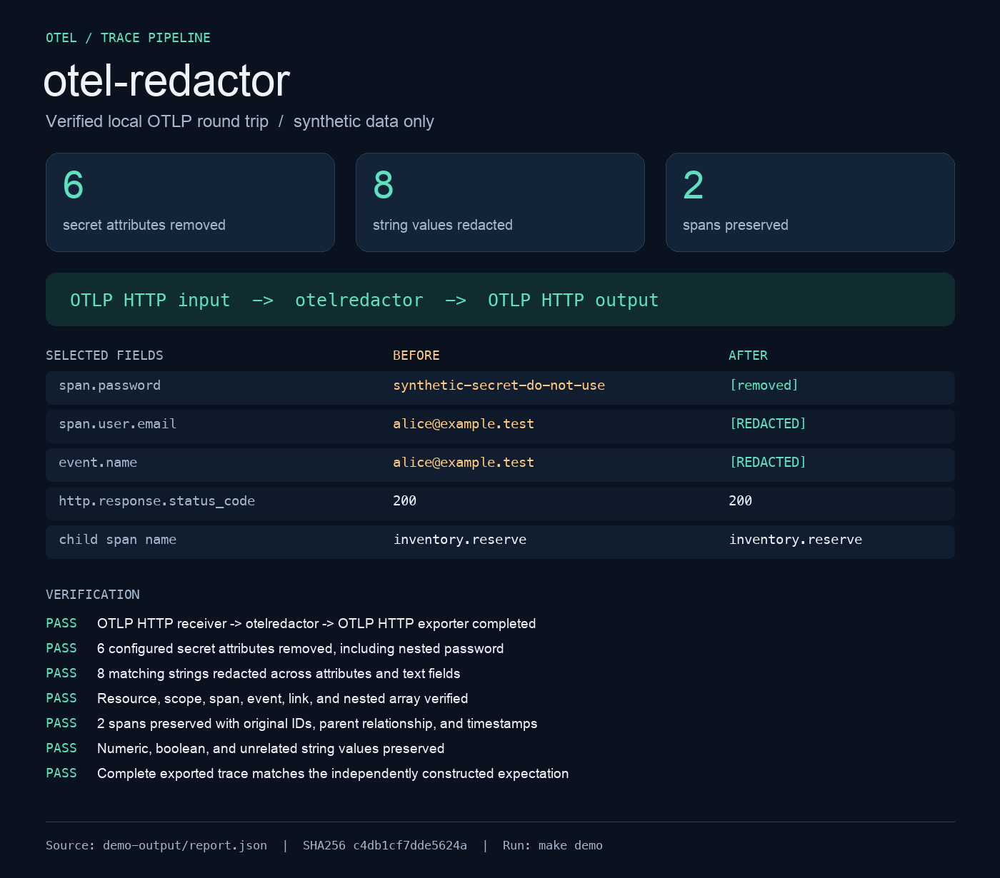

# otel-redactor

**Remove configured secrets from traces before they reach your telemetry backend.**

A Go OpenTelemetry Collector processor with recursive attribute redaction,
explicit rejection semantics, privacy-safe counters, and a runnable Collector.
This repository includes an executable OTLP HTTP demo that checks the complete
exported trace against an independently constructed expected result.



## Run the verified demo

Requirements: Go 1.26 or later, a C compiler for race tests, and network access
for the first dependency download. Docker is optional. No cloud account or
external telemetry backend is needed.

From the repository directory:

```sh
make demo
```

The demo starts an actual Collector and a local OTLP HTTP sink on ephemeral
loopback ports, sends two synthetic spans, verifies the exported data, and shuts
everything down. Expected output includes:

```text
PASS 6 configured secret attributes removed, including nested password
PASS 8 matching strings redacted across attributes and text fields
PASS 2 spans preserved with original IDs, parent relationship, and timestamps
PASS Complete exported trace matches the independently constructed expectation
PASS Collector shut down cleanly
```

Inspect `demo-output/before.json`, `after.json`, and `report.json`. These files are
synthetic local evidence and are ignored by Git. Every generated image goes in
`output-images/`. To reproduce the image, install Pillow 12.3.0 in your own Python
environment and run `python3 scripts/render_demo.py` after `make demo`.

## What it does

- Deletes exact, case-sensitive attribute keys at any nesting level.
- Replaces a whole string when any configured Go regex matches it.
- Traverses resource, scope, span, event, and link attributes, including arrays.
- Scrubs span names, event names, and status messages by default.
- Preserves trace IDs, timestamps, relationships, numeric/boolean values, and
  unrelated attributes.
- Rejects invalid policies at startup; rejects an entire batch if a retained
  value exceeds configured traversal limits. Rejected data never reaches the
  next consumer in that pipeline.
- Emits aggregate removal, replacement, and rejection counters with no
  user-derived metric labels or raw-payload processor logs.

## Run the Collector

```sh
make build
./bin/otel-redactor validate --config examples/collector.yaml
./bin/otel-redactor --config examples/collector.yaml
```

Local OTLP input: HTTP `127.0.0.1:4318`, gRPC `127.0.0.1:4317`.
Internal metrics: `127.0.0.1:8888/metrics`. The local example uses a basic debug
exporter that reports counts rather than complete payloads. To send synthetic
demo input while it is running:

```sh
curl --fail-with-body -H 'Content-Type: application/json' \
  --data-binary @demo-output/before.json http://127.0.0.1:4318/v1/traces
```

For an OTLP backend, review `examples/production.yaml` and set
`OTEL_REDACTOR_BACKEND` to its HTTPS base URL. This template still binds ingress
to loopback; remote ingestion requires an explicit authentication/TLS design.

```sh
OTEL_REDACTOR_BACKEND=https://your-backend.example:4318 \
  ./bin/otel-redactor --config examples/production.yaml
```

## Policy example

```yaml
processors:
  otelredactor:
    delete_keys: [authorization, api.key, password]
    patterns:
      - '(?i)[a-z0-9._%+\-]+@[a-z0-9.\-]+\.[a-z]{2,}'
      - '(?i)bearer\s+[a-z0-9._~+/=\-]+'
    replacement: '[REDACTED]'
    scrub_text_fields: true
    max_depth: 32
    max_string_bytes: 1048576
```

Put `otelredactor` after `memory_limiter` and before `batch` and every exporter.
The email and bearer expressions are illustrative policies, not universal PII
detectors. See the [configuration reference](docs/configuration.md) for exact
semantics, protected locations, and remaining exposure.

## Container

```sh
make container-check
docker compose up --build
```

The container runs as UID/GID 65532, has no shell, and includes CA certificates
for HTTPS export. Compose binds port 4318 to host loopback, uses a read-only
filesystem, drops Linux capabilities, and sets CPU/memory/PID limits. Stop with
`docker compose down`. The container example exports basic counts only.

## Development and validation

| Command | Purpose |
| --- | --- |
| `make check` | Formatting, vet, race tests, build, all example config checks |
| `make demo` | Real OTLP round trip and independently verified before/after data |
| `make fuzz` | Bounded recursive redaction fuzz test |
| `make bench` | Allocation/time benchmarks with a copy-only baseline |
| `make vuln` | Pinned govulncheck scanner against the current database |
| `make container-check` | Build and validate the non-root image without network |

After `make build`, `make demo`, and `make container-check`, run
`python3 scripts/smoke_runtime.py --docker` to exercise the actual CLI and Docker
container with synthetic traffic, invalid requests, live metrics, and SIGTERM.
Omit `--docker` to check only the native executable. The script uses ephemeral
loopback ports and stops all processes/containers it creates. It writes
`demo-output/runtime-checks.json`. See the
[runtime feature audit](docs/runtime-verification-2026-09-18.md) for the latest results.

See [validation results](docs/validation.md), [architecture](docs/architecture.md),
[operations](docs/operations.md), and the completed [milestone plan](PLAN.md).
CI is configured for Go 1.26/1.27; its hosted execution begins after this local
repository is pushed. The release workflow creates checksummed Linux/macOS
amd64/arm64 candidate artifacts on a version tag or manual trigger; it does not
automatically publish a GitHub release.

## Project scope

This is an independent, **alpha, traces-only** learning project with engineering
checks, not an audited production security product or an official CNCF component.
OpenTelemetry already ships a
[contrib redaction processor](https://github.com/open-telemetry/opentelemetry-collector-contrib/tree/main/processor/redactionprocessor).
Evaluate that component for established deployments. This implementation provides
a small, inspectable example of recursive policy evaluation and Collector
integration, with explicit preservation and rejection tests.

Binary values, encoded secrets, attribute key names, schema URLs, trace state,
instrumentation identity, and unconfigured patterns are not automatically
sanitized. Logs and metrics are intentionally unsupported. Read [SECURITY.md](SECURITY.md)
before using real data. License: [Apache-2.0](LICENSE).
